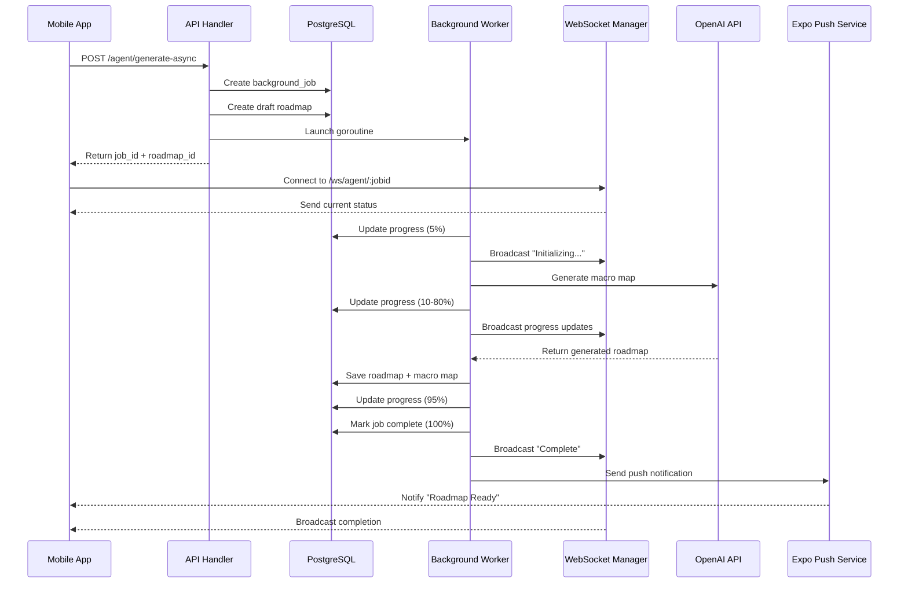

# Async Roadmap Generation - Processing Flow

This document provides a comprehensive flow diagram and step-by-step explanation of how async roadmap generation is processed in the Dead Reckoner system.

---

## Table of Contents

1. [High-Level Overview](#high-level-overview)
2. [Detailed Flow Diagram](#detailed-flow-diagram)
3. [Step-by-Step Processing](#step-by-step-processing)
4. [Component Interactions](#component-interactions)
5. [Error Handling Flow](#error-handling-flow)
6. [WebSocket Communication](#websocket-communication)
7. [Database State Transitions](#database-state-transitions)

---

## High-Level Overview



---

## Detailed Flow Diagram

### 1. Request Initiation

```
┌─────────────────────────────────────────────────────────────┐
│ Client: POST /api/v1/agent/generate-async                  │
│ Body: {                                                     │
│   goal_name: "Learn Go",                                   │
│   goal_description: "Master Go programming",               │
│   target_completion_date: "3 months",                      │
│   weekly_time_commitment: "10 hours",                      │
│   ...                                                       │
│ }                                                           │
└─────────────────────────────────────────────────────────────┘
                           │
                           ▼
┌─────────────────────────────────────────────────────────────┐
│ handlers.AgentGenerateAsync()                              │
│ - Extract user_id from auth token                         │
│ - Validate request body                                    │
└─────────────────────────────────────────────────────────────┘
                           │
                           ▼
┌─────────────────────────────────────────────────────────────┐
│ Create Background Job                                      │
│ database.CreateBackgroundJob()                             │
│ ┌─────────────────────────────────────────────────────┐   │
│ │ job_id: uuid                                        │   │
│ │ user_id: from context                               │   │
│ │ type: "roadmap_generation"                          │   │
│ │ status: "pending"                                   │   │
│ │ progress: 0                                         │   │
│ │ payload: GoalRequest                                │   │
│ └─────────────────────────────────────────────────────┘   │
└─────────────────────────────────────────────────────────────┘
                           │
                           ▼
┌─────────────────────────────────────────────────────────────┐
│ Create Draft Roadmap                                       │
│ database.CreateDraftRoadmap()                              │
│ ┌─────────────────────────────────────────────────────┐   │
│ │ roadmap_id: uuid                                    │   │
│ │ user_id: from context                               │   │
│ │ goal: "Learn Go"                                    │   │
│ │ description: "Master Go programming"                │   │
│ │ type: "ai_generated"                                │   │
│ │ job_id: reference to background_job                 │   │
│ │ generation_status: "processing"                     │   │
│ └─────────────────────────────────────────────────────┘   │
└─────────────────────────────────────────────────────────────┘
                           │
                           ▼
┌─────────────────────────────────────────────────────────────┐
│ Launch Background Worker                                   │
│ go processRoadmapGeneration(...)                           │
└─────────────────────────────────────────────────────────────┘
                           │
                           ▼
┌─────────────────────────────────────────────────────────────┐
│ Return to Client (HTTP 202 Accepted)                       │
│ {                                                           │
│   "status": "pending",                                     │
│   "job_id": "550e8400-e29b-41d4-a716-446655440000",        │
│   "roadmap_id": "660e8400-e29b-41d4-a716-446655440001",    │
│   "message": "Your roadmap is being processed",            │
│   "ws_url": "ws/agent/550e8400-..."                        │
│ }                                                           │
└─────────────────────────────────────────────────────────────┘
```

### 2. WebSocket Connection

```
┌─────────────────────────────────────────────────────────────┐
│ Client: Connect to ws://server/ws/agent/:jobid             │
│ Headers: { Authorization: Bearer <token> }                 │
└─────────────────────────────────────────────────────────────┘
                           │
                           ▼
┌─────────────────────────────────────────────────────────────┐
│ handlers.WSAgentProgress()                                 │
│ - Verify job exists and user owns it                       │
│ - Upgrade HTTP to WebSocket                                │
└─────────────────────────────────────────────────────────────┘
                           │
                           ▼
┌─────────────────────────────────────────────────────────────┐
│ websocket.Manager.AddConnection()                          │
│ - Register connection for job_id                           │
│ - Store in connections map: jobID -> []*websocket.Conn     │
└─────────────────────────────────────────────────────────────┘
                           │
                           ▼
┌─────────────────────────────────────────────────────────────┐
│ Send Current Status                                        │
│ conn.WriteJSON({                                           │
│   "type": "status",                                        │
│   "job_id": "550e8400-...",                                │
│   "progress": 0,                                           │
│   "status": "pending",                                     │
│   "message": "Initializing..."                             │
│ })                                                         │
└─────────────────────────────────────────────────────────────┘
                           │
                           ▼
┌─────────────────────────────────────────────────────────────┐
│ Keep Connection Alive                                      │
│ - Listen for ping messages                                 │
│ - Respond with pong                                        │
│ - Wait for progress updates from worker                    │
└─────────────────────────────────────────────────────────────┘
```

### 3. Background Processing

```
┌─────────────────────────────────────────────────────────────┐
│ processRoadmapGeneration() Goroutine                       │
└─────────────────────────────────────────────────────────────┘
                           │
                           ▼
┌─────────────────────────────────────────────────────────────┐
│ Progress: 5% - Initializing                                │
│ updateJobProgress(jobID, 5, "processing", "Initializing")  │
│                                                             │
│ ├─> database.UpdateBackgroundJob()                         │
│ │   └─> UPDATE background_jobs SET                         │
│ │       progress = 5, status = 'processing',              │
│ │       started_at = NOW()                                │
│ │                                                           │
│ └─> websocket.Manager.BroadcastToJob()                     │
│     └─> Send to all connected clients:                     │
│         { type: "progress", progress: 5,                   │
│           message: "Initializing AI generation..." }       │
└─────────────────────────────────────────────────────────────┘
                           │
                           ▼
┌─────────────────────────────────────────────────────────────┐
│ Progress: 10% - Generating Macro Map                       │
│ updateJobProgress(jobID, 10, "processing",                 │
│                   "Generating macro map")                  │
└─────────────────────────────────────────────────────────────┘
                           │
                           ▼
┌─────────────────────────────────────────────────────────────┐
│ AI Generation                                              │
│ agent.GenerateGoalFromStructure(ctx, req)                  │
│                                                             │
│ ┌───────────────────────────────────────────────────────┐ │
│ │ Step 1: Build Natural Language Prompt                │ │
│ │ - Convert GoalRequest fields to prose                │ │
│ │ - Include goal name, description, constraints, etc.  │ │
│ └───────────────────────────────────────────────────────┘ │
│                           │                                 │
│                           ▼                                 │
│ ┌───────────────────────────────────────────────────────┐ │
│ │ Step 2: Generate Macro Map                           │ │
│ │ - Call OpenAI API with macro_map schema              │ │
│ │ - Get high-level phases, risks, spikes               │ │
│ │ - Parse response into MacroMap struct                │ │
│ └───────────────────────────────────────────────────────┘ │
│                           │                                 │
│                           ▼                                 │
│ ┌───────────────────────────────────────────────────────┐ │
│ │ Step 3: Generate Milestone Map                       │ │
│ │ - Call OpenAI API with milestone_map schema          │ │
│ │ - Get detailed tasks for first milestone             │ │
│ │ - Parse response into Roadmap struct                 │ │
│ └───────────────────────────────────────────────────────┘ │
│                                                             │
│ Returns: GeneratedRoadmap {                                │
│   MacroMap: { phases, macro_milestones, risks, spikes }   │
│   Roadmap: { milestones, tasks, steps }                   │
│ }                                                           │
└─────────────────────────────────────────────────────────────┘
                           │
                    [Success/Error?]
                           │
           ┌───────────────┴────────────────┐
           │                                │
        Success                           Error
           │                                │
           ▼                                ▼
┌──────────────────────────┐    ┌─────────────────────────────┐
│ Progress: 80%            │    │ handleGenerationError()     │
│ Saving roadmap data      │    │ - Mark job as failed        │
└──────────────────────────┘    │ - Update roadmap status     │
           │                    │ - Broadcast error via WS    │
           ▼                    │ - Send push notification    │
┌──────────────────────────┐    │ - EXIT goroutine            │
│ Save to Database         │    └─────────────────────────────┘
│ database.Update          │
│ RoadmapWithGeneration()  │
│                          │
│ Saves:                   │
│ - Roadmap record         │
│ - MacroMap               │
│ - Phases                 │
│ - MacroMilestones        │
│ - Risks                  │
│ - Spikes                 │
│ - Milestones             │
│ - Tasks                  │
│ - Steps                  │
└──────────────────────────┘
           │
           ▼
┌──────────────────────────┐
│ Progress: 95%            │
│ Finalizing...            │
└──────────────────────────┘
           │
           ▼
┌──────────────────────────┐
│ Mark Job Complete        │
│ database.UpdateBG Job()  │
│                          │
│ - progress: 100          │
│ - status: "completed"    │
│ - completed_at: NOW()    │
│ - result: {              │
│     roadmap_id,          │
│     macromap_id          │
│   }                      │
└──────────────────────────┘
           │
           ▼
┌──────────────────────────┐
│ Broadcast Completion     │
│ websocket.Manager.       │
│ BroadcastToJob()         │
│                          │
│ Send: {                  │
│   type: "complete",      │
│   progress: 100,         │
│   message: "Ready!",     │
│   data: { roadmap_id }   │
│ }                        │
└──────────────────────────┘
           │
           ▼
┌──────────────────────────┐
│ Send Push Notification   │
│ sendPushNotification()   │
│                          │
│ - Get active tokens      │
│ - Create notification    │
│ - Call Expo API          │
│ - Update notification    │
│   status                 │
└──────────────────────────┘
```

---

## Step-by-Step Processing

### Phase 1: Request Handling (Synchronous)

**Duration:** ~50ms

1. **Receive Request** (`handlers.AgentGenerateAsync`)
   - Extract `user_id` from JWT token in middleware
   - Parse JSON body into `types.GoalRequest`
   - Validate required fields

2. **Create Background Job** (`database.CreateBackgroundJob`)
   ```sql
   INSERT INTO background_jobs (job_id, user_id, type, status, progress, payload)
   VALUES (uuid, user_id, 'roadmap_generation', 'pending', 0, jsonb);
   ```

3. **Create Draft Roadmap** (`database.CreateDraftRoadmap`)
   ```sql
   INSERT INTO roadmaps (roadmap_id, user_id, goal, description, type, job_id, generation_status)
   VALUES (uuid, user_id, goal, desc, 'ai_generated', job_id, 'processing');
   ```

4. **Launch Worker**
   - Spawn goroutine: `go processRoadmapGeneration(...)`
   - Goroutine runs independently in background

5. **Return Response** (HTTP 202)
   ```json
   {
     "status": "pending",
     "job_id": "550e8400-e29b-41d4-a716-446655440000",
     "roadmap_id": "660e8400-e29b-41d4-a716-446655440001",
     "message": "Your roadmap is being processed",
     "ws_url": "ws/agent/550e8400-e29b-41d4-a716-446655440000"
   }
   ```

### Phase 2: WebSocket Setup (Client-Initiated)

**Duration:** ~100ms

1. **Client Connects** to `/ws/agent/:jobid`
   - Sends `Authorization: Bearer <token>` header
   - Server validates token in middleware

2. **Verify Job Ownership** (`database.GetBackgroundJob`)
   ```sql
   SELECT * FROM background_jobs
   WHERE job_id = $1 AND user_id = $2;
   ```

3. **Upgrade Connection** (`websocket.UpgradeConnection`)
   - HTTP → WebSocket protocol upgrade
   - Uses gorilla/websocket upgrader

4. **Register Connection** (`websocket.Manager.AddConnection`)
   - Add to map: `connections[jobID] = append(..., conn)`
   - Thread-safe with `sync.RWMutex`

5. **Send Current Status**
   ```json
   {
     "type": "status",
     "job_id": "550e8400-...",
     "progress": 0,
     "status": "pending",
     "message": "Initializing..."
   }
   ```

6. **Start Ping/Pong Loop**
   - Client sends periodic pings
   - Server responds with pongs
   - Keeps connection alive

### Phase 3: Background Processing (Asynchronous)

**Duration:** 60-180 seconds

#### Step 1: Initialize (Progress: 5%)

**File:** `api/handlers/agent.go:187-188`

```go
updateJobProgress(jobID, 5, "processing", "Initializing AI generation...")
```

**Actions:**
- Update database: `progress = 5`, `status = 'processing'`, `started_at = NOW()`
- Broadcast WebSocket: `{ type: "progress", progress: 5, message: "Initializing AI generation..." }`

#### Step 2: Start Macro Map Generation (Progress: 10%)

**File:** `api/handlers/agent.go:189-190`

```go
updateJobProgress(jobID, 10, "processing", "Generating macro map")
```

**Actions:**
- Update database: `progress = 10`
- Broadcast WebSocket: `{ type: "progress", progress: 10, message: "Generating macro map" }`

#### Step 3: AI Generation (Progress: 10% → 80%)

**File:** `api/handlers/agent.go:191-195`

```go
generated, err := agent.GenerateGoalFromStructure(ctx, req)
if err != nil {
    handleGenerationError(jobID, roadmapID, userID, err)
    return
}
```

**Sub-steps in `agent.GenerateGoalFromStructure`:**

1. **Build Prompt** (`agent/agent.go:72-93`)
   - Convert structured `GoalRequest` to natural language
   - Include all fields: goal, description, importance, time commitment, etc.

2. **Generate Macro Map** (`agent/agent.go` - internal)
   - Call OpenAI API: `POST https://api.openai.com/v1/responses`
   - Schema: `macro_map_schema` (phases, macro_milestones, risks, spikes)
   - Model: `gpt-5-mini` or `gpt-5-nano`
   - Parse JSON response into `types.MacroMap`

3. **Generate Milestone Map** (`agent/agent.go` - internal)
   - Call OpenAI API again
   - Schema: `milestone_map_schema` (milestones, tasks, steps)
   - Extract first milestone details
   - Parse JSON response into `types.Roadmap`

4. **Return Combined Result**
   ```go
   &GeneratedRoadmap{
       MacroMap: macroMap,
       Roadmap: roadmap,
   }
   ```

#### Step 4: Save to Database (Progress: 80% → 95%)

**File:** `api/handlers/agent.go:196-205`

```go
updateJobProgress(jobID, 80, "processing", "Saving roadmap data...")

generated.Roadmap.RoadmapID = roadmapID
generated.Roadmap.UserID = userID
generated.Roadmap.Type = "ai_generated"

if err := database.UpdateRoadmapWithGeneration(ctx, generated.Roadmap); err != nil {
    handleGenerationError(jobID, roadmapID, userID, err)
    return
}

updateJobProgress(jobID, 95, "processing", "Finalizing...")
```

**Database Operations** (`database/database.go:1608-1688`):
- Generate UUIDs for all nested entities
- Save MacroMap with phases, macro milestones, risks, spikes
- Save Roadmap with milestones, tasks, steps
- All saved in single transaction

#### Step 5: Mark Complete (Progress: 100%)

**File:** `api/handlers/agent.go:209-231`

```go
now := time.Now()
job := types.BackgroundJob{
    JobID: jobID,
    Status: "completed",
    Progress: 100,
    CompletedAt: &now,
    Result: map[string]any{
        "roadmap_id": roadmapID,
        "macromap_id": generated.MacroMap.MacroMapID,
    },
}
database.UpdateBackgroundJob(ctx, &job)

websocket.Manager.BroadcastToJob(ctx, jobID, types.ProgressUpdate{
    Type: "complete",
    JobID: jobID,
    Progress: 100,
    Status: "completed",
    Message: "Your roadmap is ready for review...",
    Data: map[string]any{"roadmap_id": roadmapID},
})
```

**Database Update:**
```sql
UPDATE background_jobs
SET progress = 100,
    status = 'completed',
    completed_at = NOW(),
    result = '{"roadmap_id": "...", "macromap_id": "..."}'
WHERE job_id = $1;
```

**WebSocket Broadcast:**
```json
{
  "type": "complete",
  "job_id": "550e8400-...",
  "progress": 100,
  "status": "completed",
  "message": "Your roadmap is ready for review...",
  "data": {
    "roadmap_id": "660e8400-..."
  }
}
```

#### Step 6: Send Push Notification

**File:** `api/handlers/agent.go:233-237, 317-339`

```go
sendPushNotification(userID, "roadmap_complete",
    "Your roadmap is ready for review!",
    fmt.Sprintf("Your %s roadmap has been generated successfully.", req.GoalName),
    map[string]any{"roadmap_id": roadmapID})
```

**Sub-steps:**

1. **Get Active Tokens** (`database.GetActivePushTokens`)
   ```sql
   SELECT * FROM push_tokens
   WHERE user_id = $1 AND is_active = true;
   ```

2. **Create Notification Record** (`database.CreateNotification`)
   ```sql
   INSERT INTO notifications (notification_id, user_id, type, title, body, data, status)
   VALUES (uuid, user_id, 'roadmap_complete', title, body, jsonb, 'pending');
   ```

3. **Send to Expo API** (`sendExpoNotification`)
   ```go
   POST https://exp.host/--/api/v2/push/send
   {
     "to": "ExponentPushToken[xxxxxxxxxxxxxxxxxxxxxx]",
     "title": "Your roadmap is ready for review!",
     "body": "Your Learn Go roadmap has been generated successfully.",
     "data": { "roadmap_id": "660e8400-..." },
     "sound": "default",
     "priority": "high"
   }
   ```

4. **Update Notification Status**
   ```sql
   UPDATE notifications
   SET status = 'sent', sent_at = NOW()
   WHERE notification_id = $1;
   ```

---

## Component Interactions

### 1. API Handler ↔ Database

**Purpose:** Persist job state and roadmap data

**Key Functions:**
- `database.CreateBackgroundJob()`
- `database.CreateDraftRoadmap()`
- `database.UpdateBackgroundJob()`
- `database.UpdateRoadmapWithGeneration()`

**Database Tables:**
- `background_jobs` - Tracks job lifecycle
- `roadmaps` - Stores roadmap metadata
- `macro_maps` - Strategic planning layer
- `phases`, `macro_milestones`, `risks`, `spikes` - Macro map details
- `milestones`, `tasks`, `steps` - Tactical execution layer

### 2. Background Worker ↔ WebSocket Manager

**Purpose:** Real-time progress updates

**Communication Flow:**
```go
// Worker updates progress
updateJobProgress(jobID, 50, "processing", "Halfway done...")
  │
  ├─> database.UpdateBackgroundJob() // Persist to DB
  │
  └─> websocket.Manager.BroadcastToJob() // Notify clients
        │
        └─> For each connection in connections[jobID]:
              conn.WriteJSON(progressUpdate)
```

**Manager Implementation:**
```go
type ConnectionManager struct {
    connections map[string][]*websocket.Conn // jobID → connections
    mutex       sync.RWMutex                  // Thread-safe access
}
```

### 3. Background Worker ↔ AI Agent

**Purpose:** Generate roadmap content

**Flow:**
```
processRoadmapGeneration()
  │
  └─> agent.GenerateGoalFromStructure(ctx, req)
        │
        ├─> Build natural language prompt
        │
        ├─> Generate macro map
        │   └─> POST to OpenAI API
        │       └─> Parse JSON response
        │
        ├─> Generate milestone map
        │   └─> POST to OpenAI API
        │       └─> Parse JSON response
        │
        └─> Return GeneratedRoadmap
```

### 4. Background Worker ↔ Push Notification Service

**Purpose:** Notify user when complete or failed

**Flow:**
```
sendPushNotification(userID, type, title, body, data)
  │
  ├─> database.GetActivePushTokens(userID)
  │
  ├─> database.CreateNotification(...)
  │
  └─> For each token:
        go sendExpoNotification(token, ...)
          │
          ├─> POST to Expo Push API
          │
          └─> database.UpdateNotificationStatus(...)
```

---

## Error Handling Flow

### When Errors Occur

**Possible Failure Points:**
1. OpenAI API timeout or error
2. Database save failure
3. Invalid response parsing
4. Network issues

**Error Handler** (`handleGenerationError` in `api/handlers/agent.go:265-295`):

```go
func handleGenerationError(jobID, roadmapID, userID string, err error) {
    ctx := context.Background()
    now := time.Now()

    // 1. Update job as failed
    job := types.BackgroundJob{
        JobID: jobID,
        Status: "failed",
        Error: err.Error(),
        CompletedAt: &now,
    }
    database.UpdateBackgroundJob(ctx, &job)

    // 2. Update roadmap status
    database.UpdateRoadmapGenerationStatus(ctx, roadmapID, "failed")

    // 3. Broadcast error via WebSocket
    websocket.Manager.BroadcastToJob(ctx, jobID, types.ProgressUpdate{
        Type: "error",
        JobID: jobID,
        Status: "failed",
        Message: "Failed to generate roadmap",
        Data: map[string]string{"error": err.Error()},
    })

    // 4. Send push notification
    sendPushNotification(userID, "roadmap_failed",
        "Roadmap Generation Failed",
        "We encountered an issue. Please try again.",
        map[string]any{
            "roadmap_id": roadmapID,
            "error": err.Error(),
        })
}
```

**Database State After Error:**

```sql
-- background_jobs table
job_id   | status  | error              | completed_at
---------|---------|--------------------|--------------
550e...  | failed  | OpenAI timeout...  | 2025-12-10...

-- roadmaps table
roadmap_id | generation_status | job_id
-----------|-------------------|--------
660e...    | failed            | 550e...
```

**Client Notification:**

**WebSocket:**
```json
{
  "type": "error",
  "job_id": "550e8400-...",
  "status": "failed",
  "message": "Failed to generate roadmap",
  "data": {
    "error": "OpenAI API timeout: context deadline exceeded"
  }
}
```

**Push Notification:**
```json
{
  "title": "Roadmap Generation Failed",
  "body": "We encountered an issue. Please try again.",
  "data": {
    "roadmap_id": "660e8400-...",
    "error": "OpenAI API timeout..."
  }
}
```

---

## WebSocket Communication

### Message Types

#### 1. Status Message
**When:** Initial connection, job already in progress
```json
{
  "type": "status",
  "job_id": "550e8400-...",
  "progress": 45,
  "status": "processing",
  "message": "Creating detailed tasks..."
}
```

#### 2. Progress Update
**When:** Job progress changes (5%, 10%, 80%, 95%)
```json
{
  "type": "progress",
  "job_id": "550e8400-...",
  "progress": 80,
  "status": "processing",
  "message": "Saving roadmap data..."
}
```

#### 3. Complete Message
**When:** Job finishes successfully
```json
{
  "type": "complete",
  "job_id": "550e8400-...",
  "progress": 100,
  "status": "completed",
  "message": "Your roadmap is ready for review...",
  "data": {
    "roadmap_id": "660e8400-..."
  }
}
```

#### 4. Error Message
**When:** Job fails
```json
{
  "type": "error",
  "job_id": "550e8400-...",
  "status": "failed",
  "message": "Failed to generate roadmap",
  "data": {
    "error": "OpenAI API timeout"
  }
}
```

#### 5. Ping/Pong
**When:** Keep-alive mechanism
```json
// Client sends:
{ "type": "ping" }

// Server responds:
{ "type": "pong" }
```

### Connection Lifecycle

```
┌─────────────────────────────────────────────────────────────┐
│ 1. Client connects to /ws/agent/:jobid                      │
│    - Middleware validates JWT token                         │
│    - Handler verifies job ownership                         │
└─────────────────────────────────────────────────────────────┘
                           │
                           ▼
┌─────────────────────────────────────────────────────────────┐
│ 2. HTTP → WebSocket upgrade                                 │
│    - gorilla/websocket.Upgrader                             │
│    - CheckOrigin: returns true (TODO: restrict in prod)     │
└─────────────────────────────────────────────────────────────┘
                           │
                           ▼
┌─────────────────────────────────────────────────────────────┐
│ 3. Register connection                                      │
│    - websocket.Manager.AddConnection(jobID, conn)           │
│    - Stored in map: connections[jobID] = [..., conn]        │
└─────────────────────────────────────────────────────────────┘
                           │
                           ▼
┌─────────────────────────────────────────────────────────────┐
│ 4. Send current status                                      │
│    - Query database for latest job state                    │
│    - conn.WriteJSON(currentStatus)                          │
└─────────────────────────────────────────────────────────────┘
                           │
                           ▼
┌─────────────────────────────────────────────────────────────┐
│ 5. Listen for messages (infinite loop)                      │
│    for {                                                    │
│      var msg map[string]any                                 │
│      if err := conn.ReadJSON(&msg); err != nil {            │
│        break // Client disconnected                         │
│      }                                                       │
│      if msg["type"] == "ping" {                             │
│        conn.WriteJSON({"type": "pong"})                     │
│      }                                                       │
│    }                                                         │
└─────────────────────────────────────────────────────────────┘
                           │
                           ▼
┌─────────────────────────────────────────────────────────────┐
│ 6. Meanwhile: Worker broadcasts updates                     │
│    - updateJobProgress() calls BroadcastToJob()             │
│    - All connections for jobID receive update               │
│    - Non-blocking: each send in separate goroutine          │
└─────────────────────────────────────────────────────────────┘
                           │
                           ▼
┌─────────────────────────────────────────────────────────────┐
│ 7. Client disconnects                                       │
│    - ReadJSON() returns error                               │
│    - Break from loop                                        │
│    - defer websocket.Manager.RemoveConnection()             │
│    - defer conn.Close()                                     │
└─────────────────────────────────────────────────────────────┘
```

### Broadcast Mechanism

**Thread-Safe Broadcasting** (`websocket/manager.go:70-84`):

```go
func (m *ConnectionManager) BroadcastToJob(ctx context.Context, jobID string, update types.ProgressUpdate) {
    m.mutex.RLock()  // Read lock (multiple readers allowed)
    defer m.mutex.RUnlock()

    connections := m.connections[jobID]
    for _, conn := range connections {
        // Non-blocking send (don't wait for slow clients)
        go func(c *websocket.Conn) {
            if err := c.WriteJSON(update); err != nil {
                log.Info(ctx, "Error broadcasting job", jobID, update)
                // Connection likely dead, will be cleaned up on next read
            }
        }(conn)
    }
}
```

**Key Features:**
- **Read lock:** Multiple broadcasts can happen simultaneously
- **Non-blocking:** Each connection write in separate goroutine
- **Graceful degradation:** Failed writes logged, connection cleaned up later
- **No client blocking:** Slow clients don't affect others

---

## Database State Transitions

### background_jobs Table

```
┌──────────┐
│ pending  │  Initial state when job created
└────┬─────┘
     │
     ▼
┌──────────┐
│processing│  Worker starts, progress: 5% → 95%
└────┬─────┘
     │
     ├─────────────────┐
     │                 │
     ▼                 ▼
┌──────────┐      ┌────────┐
│completed │      │ failed │
└──────────┘      └────────┘
  progress: 100     error field populated
  completed_at set  completed_at set
  result set
```

**State Transitions:**

```sql
-- 1. Created (pending)
INSERT INTO background_jobs (job_id, user_id, type, status, progress)
VALUES ('550e...', 'user123', 'roadmap_generation', 'pending', 0);

-- 2. Started (processing)
UPDATE background_jobs
SET status = 'processing', progress = 5, started_at = NOW()
WHERE job_id = '550e...';

-- 3. Progress updates
UPDATE background_jobs SET progress = 10 WHERE job_id = '550e...';
UPDATE background_jobs SET progress = 80 WHERE job_id = '550e...';
UPDATE background_jobs SET progress = 95 WHERE job_id = '550e...';

-- 4a. Success (completed)
UPDATE background_jobs
SET status = 'completed', progress = 100, completed_at = NOW(),
    result = '{"roadmap_id": "660e...", "macromap_id": "770e..."}'
WHERE job_id = '550e...';

-- 4b. Failure (failed)
UPDATE background_jobs
SET status = 'failed', completed_at = NOW(),
    error = 'OpenAI API timeout: context deadline exceeded'
WHERE job_id = '550e...';
```

### roadmaps Table

```
┌────────────┐
│ processing │  Draft created with job_id reference
└─────┬──────┘
      │
      ├──────────────┐
      │              │
      ▼              ▼
┌───────────┐   ┌────────┐
│ completed │   │ failed │
└───────────┘   └────────┘
  Full data      Placeholder
  populated      remains empty
```

**State Transitions:**

```sql
-- 1. Draft created (processing)
INSERT INTO roadmaps (roadmap_id, user_id, goal, description, type, job_id, generation_status)
VALUES ('660e...', 'user123', 'Learn Go', 'Master Go...',
        'ai_generated', '550e...', 'processing');

-- 2a. Success (completed)
-- First: Update roadmap with all generated data
UPDATE roadmaps
SET generation_status = 'completed'
WHERE roadmap_id = '660e...';

-- Nested data saved via GORM:
-- - macro_maps record
-- - phases records
-- - macro_milestones records
-- - risks records
-- - spikes records
-- - milestones records
-- - tasks records
-- - steps records

-- 2b. Failure (failed)
UPDATE roadmaps
SET generation_status = 'failed'
WHERE roadmap_id = '660e...';
-- Roadmap remains as placeholder (can be deleted or retried)
```

### notifications Table

```
┌─────────┐
│ pending │  Notification created
└────┬────┘
     │
     ├──────────────┐
     │              │
     ▼              ▼
┌──────┐       ┌────────┐
│ sent │       │ failed │
└───┬──┘       └────────┘
    │           error field
    │           populated
    ▼
┌──────┐
│ read │  User viewed notification
└──────┘
```

---

## Summary

The async roadmap generation system provides a robust, scalable solution for handling long-running AI operations:

1. **Non-blocking API:** Returns immediately with job_id, client doesn't wait
2. **Real-time Updates:** WebSocket broadcasts progress (5% → 100%)
3. **Background Resilience:** Push notifications ensure user gets result even if app closed
4. **Error Handling:** Comprehensive error states, notifications, and recovery
5. **Scalability:** Goroutines handle concurrent generations, WebSocket manager handles multiple clients
6. **Database Tracking:** Full audit trail of job lifecycle and roadmap generation

**Key Files:**
- `api/handlers/agent.go` - Request handling, worker orchestration
- `websocket/manager.go` - WebSocket connection management
- `agent/agent.go` - AI generation logic
- `database/database.go` - Persistence layer
- `types/types.go` - Data structures

**Total Processing Time:** 60-180 seconds (depends on OpenAI API latency)
